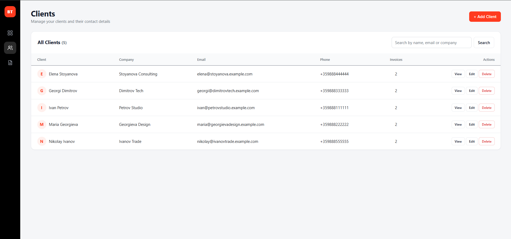
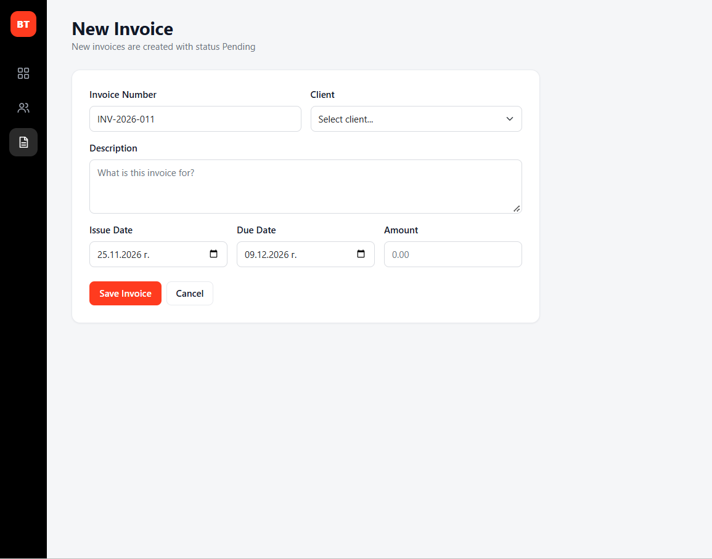
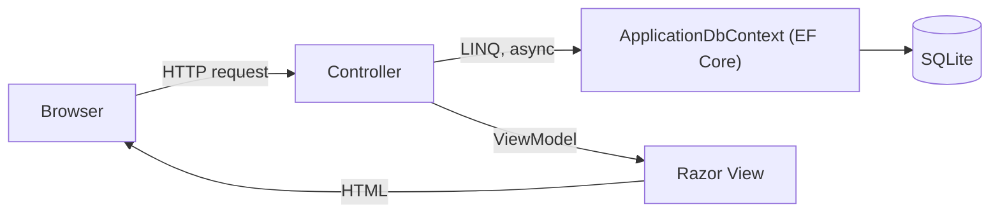
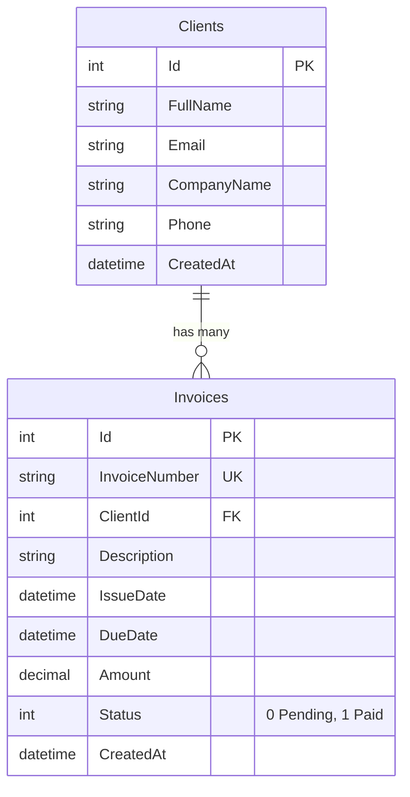

# BillTrack

**Invoice & Payment Management System** built with **ASP.NET Core MVC (.NET 8)**, Entity Framework Core and SQLite.


BillTrack lets small businesses, freelancers and entrepreneurs manage their clients, issue invoices and track payments from a single dashboard. It was built as a portfolio project that follows common professional practices: MVC separation of concerns, dependency injection, strongly typed views, EF Core migrations, validation and async data access.

## Screenshots

| Dashboard | Clients |
|---|---|
|  |  |

| Invoices (filtered by Overdue) | Form validation |
|---|---|
|  |  |

## Features

- **Dashboard** - total invoices, total revenue, paid amount, pending amount, overdue invoices and the most recent invoices, all calculated from the database with LINQ.
- **Client management** - create, view, edit, delete and search clients. Emails are validated and must be unique. A client that has invoices cannot be deleted.
- **Invoice management** - create, view, edit and delete invoices linked to a client. The next invoice number (for example `INV-2026-011`) is suggested automatically and must be unique.
- **Payment status** - new invoices start as `Pending` and can be marked as `Paid`. An unpaid invoice past its due date is shown as `Overdue`. A paid invoice never becomes overdue.
- **Search, filtering and sorting** - search by invoice number or client name, filter by status and issue date range, sort by date or due date, with pagination that keeps the active filters.
- **Validation** - Data Annotations, cross-field rules (the due date cannot be before the issue date), server-side uniqueness checks and a unique database index.
- **Security basics** - anti-forgery tokens on every POST action, protection against overposting (ViewModels and `[Bind]`) and local-only redirects.
- **Duplicate submit protection** - submit buttons lock after the first click and unique constraint violations are handled gracefully on the server.
- **Responsive UI** - SaaS-style dashboard with a sidebar, built with Bootstrap 5 and custom CSS.

## Business Rules

| Rule | Implementation |
|---|---|
| New invoices start as `Pending` | Set in `InvoicesController.Create` |
| `Overdue` is calculated, not stored | `Invoice.EffectiveStatus` and LINQ queries compare `DueDate` with today |
| Paid invoices are never overdue | `Status == Paid` always wins |
| Invoice numbers are unique | Controller validation plus a unique index in the database |
| A client with invoices cannot be deleted | Controller check plus `DeleteBehavior.Restrict` |

## Architecture



```
BillTrack/
├── BillTrack.sln
├── README.md
├── docs/screenshots/        Screenshots used in this README
└── BillTrack/               ASP.NET Core MVC project
    ├── Controllers/         Dashboard, Clients, Invoices, Home
    ├── Data/                ApplicationDbContext, DbSeeder
    ├── Helpers/             Money and date formatting extensions
    ├── Migrations/          EF Core migrations
    ├── Models/              Client, Invoice, InvoiceStatus
    ├── ViewModels/          Dashboard, client list and invoice form view models
    ├── Views/               Razor views and shared partials
    ├── wwwroot/             CSS, JavaScript, static files
    ├── appsettings.json
    └── Program.cs
```

## Database



On the first run the application applies the migrations, creates `billtrack.db` and seeds sample data: 5 clients and 10 invoices with a mix of paid, pending and overdue statuses. Sample dates are relative to the current day, so the dashboard looks realistic on any date.

## Key Technical Decisions

- **ViewModels instead of binding entities.** Forms and the dashboard use dedicated view models. This prevents overposting and keeps UI concerns out of the domain models.
- **Overdue is derived, not stored.** The database only stores `Pending` or `Paid`. `Overdue` is calculated from the due date, so the data can never become stale.
- **Filtering and pagination run in SQL.** Queries are composed as `IQueryable` (`Where`, `OrderBy`, `Skip`, `Take`), so the database does the work in a single query.
- **SQLite and `decimal`.** SQLite cannot sum `decimal` values in SQL, so aggregates are computed as `double` and rounded to 2 decimals.
- **Concurrency-safe uniqueness.** Invoice numbers are checked in code and enforced by a unique index. A `DbUpdateException` caused by a unique violation (SQLite error 19) is turned into a validation message instead of an error page.
- **Relative seed data.** A `DbSeeder` creates sample data relative to today instead of fixed dates in a migration.
- **Fixed request culture (`en-US`).** Decimal input behaves the same regardless of the operating system's regional settings.

## Technologies Used

| Area | Technology |
|---|---|
| Language | C# |
| Framework | ASP.NET Core MVC (.NET 8) |
| Data access | Entity Framework Core 8 (Code First, Migrations) |
| Database | SQLite |
| Views | Razor Views (strongly typed) |
| UI | Bootstrap 5, HTML5, CSS3, JavaScript |
| Querying | LINQ |
| Other | Dependency Injection, Data Annotations, Git and GitHub |

## Getting Started

**Prerequisites:** [.NET 8 SDK](https://dotnet.microsoft.com/download/dotnet/8.0) and Git.

```bash
git clone https://github.com/YasinMustafa04/BillTrack.git
cd BillTrack/BillTrack
dotnet run
```

Open the address printed in the console (by default `http://localhost:5055`). The database is created and seeded automatically on the first start. Alternatively, open `BillTrack.sln` in Visual Studio 2022 and press **F5**.

To reset the data, stop the app and delete the `billtrack.db` file. It will be recreated on the next start.

## Future Improvements

- Unit tests (xUnit) for the overdue rule and the validation logic.
- Move the overdue rule into one reusable place (query extensions or a service layer) instead of repeating it in the model and in queries.
- Unique index for the client email at database level.
- Authentication and per-user data.
- PDF export of invoices and email reminders for overdue invoices.
- Case-insensitive search for non-Latin characters (a SQLite limitation), or a move to SQL Server.
- Logging and custom error pages.
- CI with GitHub Actions (build and test on every push).

## License

MIT (see the `LICENSE` file).

## Author

**Yasin Mustafa** - Business Information Technologies student at Plovdiv University, aspiring .NET developer, open to Junior .NET Developer and internship opportunities.

GitHub: [@YasinMustafa04](https://github.com/YasinMustafa04)
