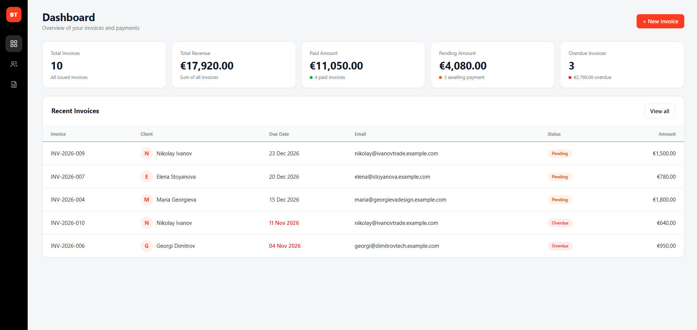
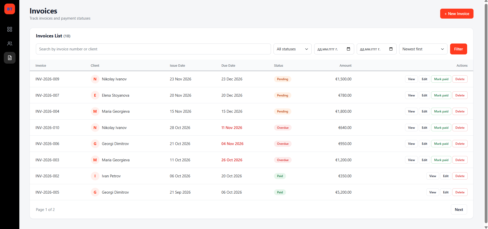

# BillTrack

**Invoice & Payment Management System** for small businesses, freelancers and entrepreneurs, built with ASP.NET Core MVC, Entity Framework Core and SQLite.

## Project Overview

BillTrack lets you manage clients, issue invoices and track payments from a single place. A dashboard shows live financial statistics calculated from the database with LINQ and EF Core. The project was built as a portfolio application following common professional practices: MVC separation of concerns, dependency injection, strongly typed views, migrations, validation and async data access.

## Features

- **Dashboard** - total invoices, total revenue, paid amount, pending amount, overdue invoices and the most recent invoices.
- **Client management** - create, view, edit, delete and search clients. Email addresses are validated and must be unique. Clients that have invoices cannot be deleted.
- **Invoice management** - create, view, edit and delete invoices linked to a client. Invoice numbers are suggested automatically (`INV-2026-011`) and must be unique.
- **Payment status** - new invoices start as `Pending`. An invoice can be marked as `Paid`. An unpaid invoice past its due date is shown as `Overdue`. A paid invoice never becomes overdue.
- **Search, filtering and sorting** - search by invoice number or client name, filter by status and issue date range, sort by date or due date, with pagination that keeps the active filters.
- **Validation** - Data Annotations, cross-field rules (due date cannot be before issue date), server-side uniqueness checks and a database unique index.
- **Security basics** - anti-forgery tokens on all POST actions, protection against overposting (ViewModels and `[Bind]`), local-only redirects.
- **Duplicate submit protection** - the submit button locks after the first click, and unique constraint violations are handled gracefully on the server.
- **Responsive UI** - SaaS-style dashboard layout with a sidebar, built with Bootstrap 5 and custom CSS.

## Business Rules

| Rule | Implementation |
|---|---|
| New invoices are `Pending` | Set in `InvoicesController.Create` |
| `Overdue` is calculated, not stored | `Invoice.EffectiveStatus` and LINQ queries compare `DueDate` with today |
| Paid invoices are never overdue | `Status == Paid` always wins |
| Invoice numbers are unique | Validation in the controller plus a unique index in the database |
| A client with invoices cannot be deleted | Controller check plus `DeleteBehavior.Restrict` |

## Technologies Used

| Area | Technology |
|---|---|
| Language | C# |
| Framework | ASP.NET Core MVC (.NET 8) |
| Data access | Entity Framework Core 8 (Code First, Migrations) |
| Database | SQLite |
| Views | Razor Views (strongly typed) |
| UI | Bootstrap 5, HTML5, CSS3, JavaScript |
| Querying | LINQ |
| Other | Dependency Injection, Data Annotations, Git and GitHub |

## Project Structure
BillTrack/
|-- BillTrack.sln
|-- README.md
|-- docs/screenshots/
-- BillTrack/ |-- Controllers/ Dashboard, Clients, Invoices, Home |-- Data/ ApplicationDbContext, DbSeeder |-- Helpers/ FormatHelper (money and date formatting) |-- Migrations/ EF Core migrations |-- Models/ Client, Invoice, InvoiceStatus |-- ViewModels/ DashboardViewModel, InvoiceFormViewModel, ... |-- Views/ Razor views and partials |-- wwwroot/ CSS, JavaScript, static files |-- appsettings.json -- Program.cs


## Database

- **Clients** (Id, FullName, Email, CompanyName, Phone, CreatedAt)
- **Invoices** (Id, InvoiceNumber, ClientId, Description, IssueDate, DueDate, Amount, Status, CreatedAt)
- One client has many invoices (one-to-many) through the `ClientId` foreign key.
- `InvoiceNumber` has a unique index.
- On first run the application applies the migrations, creates `billtrack.db` and seeds sample data: 5 clients and 10 invoices with a mix of paid, pending and overdue statuses. Sample dates are relative to the current day, so the dashboard always looks realistic.

## Installation Instructions

Prerequisites:

- [.NET 8 SDK](https://dotnet.microsoft.com/download/dotnet/8.0)
- Git

```bash
git clone https://github.com/YasinMustafa04/BillTrack.git
cd BillTrack/BillTrack
dotnet restore
```

## How to Run

```bash
dotnet run
```

Open the address printed in the console (by default `http://localhost:5055`). The database is created and seeded automatically on the first start. To reset the data, stop the app and delete the `billtrack.db` file.

## Screenshots

### Dashboard


### Clients


### Invoices (filtered by Overdue)


### Invoice form with validation


## Future Improvements

- Unit tests (xUnit) for the overdue rule and validation logic.
- Move the overdue rule into one reusable place (query extensions or a service layer) instead of repeating it in the model and in queries.
- Unique index for client email at database level.
- Authentication and per-user data.
- PDF export of invoices and email reminders for overdue invoices.
- Case-insensitive search for non-Latin characters (SQLite limitation), or a move to SQL Server.
- Logging and custom error pages.
- CI with GitHub Actions (build and test on every push).

## Author

**Yasin Mustafa** - Business Information Technologies student at Plovdiv University, aspiring .NET developer.

